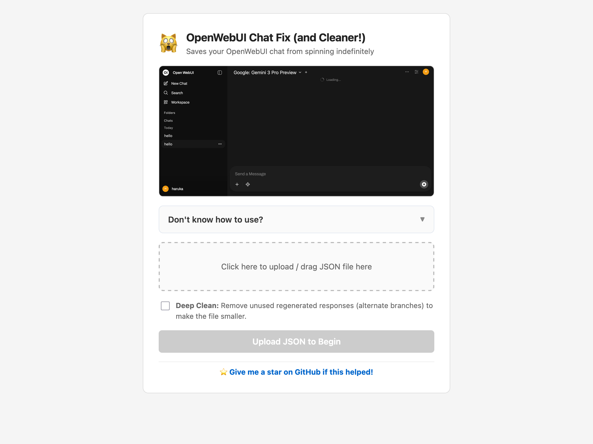
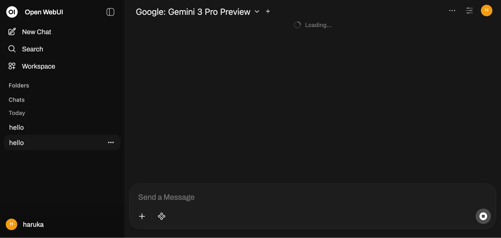

<!-- markdownlint-disable MD033 -->

# Open WebUI Tools

A collection of tools, filters and fixes for
[Open WebUI](https://github.com/open-webui/open-webui). Each project
lives in its own folder and can be used on its own.

Maintained by [@fractuscontext](https://github.com/fractuscontext).

## Contents

* [Repair tools](#repair-tools)
  * [Chat Fix](#chat-fix)
* [Functions](#functions)
  * [Token Saver Reloaded](#token-saver-reloaded)
  * [Simple Prompt](#simple-prompt)
  * [Installation](#installation)
* [Repository layout](#repository-layout)
* [Related issues](#related-issues)
* [License](#license)

## Repair tools

### Chat Fix

[Chat Fix](./chat-fix) rescues Open WebUI chats that get stuck on the infinite "Loading..." spinner, or that crash back to the home page. It can also clean up retries, removing the regenerated responses you no longer need.

🔗 [**Launch the Repair Tool**](https://fractuscontext.github.io/open-webui-tools/chat-fix/)

The bug happens when a chat's internal message tree has broken links, usually after network interruptions, API errors or third-party tools. Chat Fix repairs the exported JSON so you can import the chat back into Open WebUI.

Usage instructions are built into the page under **"Don't know how to use?"**.

* **Repair** reconnects detached messages and fixes the `currentId` pointer so the chat opens again.
* **Non-destructive** keeps the entire history, including alternate generation branches.
* **Prune mode** cleans up retries: it keeps only the active conversation path and drops every unused regenerated response.
* Pure vanilla JS with no NPM, frameworks or build step. Your chat file never leaves the browser.

<b>The "Loading..." spinner</b>

<b>Technical details</b>

* Resolves `currentId` pointers that reference non-existent nodes.
* Prunes `childrenIds` arrays of invalid or dangling IDs.
* Prune mode rebuilds the tree along a single linear path from the root to the most recently timestamped leaf.
* To test it yourself, import [`bad-test-1.json`](./chat-fix/tests/bad-test-1.json) into Open WebUI to reproduce the crash, run it through the tool, then re-import the result to confirm the fix.

## Functions

Filter functions that run on every request before it reaches the model.

### Token Saver Reloaded

[`token-saver-reloaded.py`](./functions/token-saver-reloaded.py) cuts token usage and cost on long chats.

* **History trimming** sends only the last N messages to the provider.
* **Timestamp injection** fetches real timestamps from the Open WebUI API and adds them to past messages, so the model knows what time it is.
* **Smart context lookup** searches the trimmed messages with semantic (`sentence-transformers`) or keyword (`rank-bm25`) matching and appends relevant hits as `<recovered_memory>`.
* **Image pruning** strips image attachments from older messages.
* **Token optimizer** removes filler words and corporate jargon from user messages without touching code blocks, formatting or quotes. Off by default.

<b>Valves</b>

| Valve | Default | Description |
| :--- | :---: | :--- |
| `priority` | `0` | Execution order (higher runs later). |
| `n_last_messages` | `50` | Messages to keep (user and assistant each count as 1). |
| `supplementary_messages_to_be_sent` | `3` | Extra relevant past messages to retrieve beyond the cutoff. `0` disables lookup. |
| `use_bm25_instead_of_sentence_transformer` | `False` | `True` uses lightweight BM25 keyword search, `False` uses PyTorch semantic search. |
| `debug_mode` | `False` | Logs diagnostics (library status, forgotten messages, evaluation time) to the server log as WARNING. |
| `ignore_images_after_n_messages` | `10` | Keep images only in the last N messages. |
| `api_base_url` | `http://127.0.0.1:8080` | Open WebUI API base URL, used to fetch message timestamps. |
| `inject_system_instructions` | `True` | Tell the model in the System Prompt how to read the injected time data. |
| `enable_token_optimizer` | `False` | Remove common filler words from user messages. |
| `min_words_to_optimize` | `60` | Skip optimization for shorter messages. |
| `max_words_to_optimize` | `2000` | Skip optimization for very long messages. |
| `optimize_current_only` | `True` | Only optimize the current (last) message. |

<b>Requirements</b>

* `httpx>=0.24.0` (usually bundled with Open WebUI)
* `rank-bm25` for keyword search
* `sentence-transformers` and `torch` for semantic search

### Simple Prompt

[`simple-prompt.py`](./functions/simple-prompt.py) appends your own instructions to the System Prompt. Out of the box, it pushes the model toward short, structured answers.

* **Built-in prompt** sets a soft target word count, suppresses preambles such as "As an AI" and filler phrases, and favors headers and bullet points over long prose.
* **Custom prompt** lets you add your own instructions after the built-in one, or replace it entirely.
* Pairs well with Token Saver Reloaded. No extra dependencies.

<b>Valves</b>

| Valve | Default | Description |
| :--- | :---: | :--- |
| `priority` | `0` | Execution order (higher runs later). |
| `target_word_count` | `240` | Soft word-count target, substituted for `{target_word_count}` in the prompts. |
| `system_prompt` | built-in prompt | Main instructions. Edit to change them, or clear to disable. |
| `additional_prompt` | blank | Extra instructions appended after `system_prompt`. Ignored while blank. |

### Installation

Requires Open WebUI v0.8.4 or higher.

* Go to **Admin Panel** → **Functions** → **Import From Link**.
* Paste one of the raw URLs:
  * [`token-saver-reloaded.py`](https://raw.githubusercontent.com/fractuscontext/open-webui-tools/main/functions/token-saver-reloaded.py)
  * [`simple-prompt.py`](https://raw.githubusercontent.com/fractuscontext/open-webui-tools/main/functions/simple-prompt.py)
* Enable the filter.

## Repository layout

* [`chat-fix/`](./chat-fix) is the static chat repair web app, served on GitHub Pages.
* [`functions/`](./functions) holds the Open WebUI filter functions, one `.py` file per function.

## Related issues

* [open-webui#15189](https://github.com/open-webui/open-webui/issues/15189) and [open-webui#19225](https://github.com/open-webui/open-webui/issues/19225) cover the "Loading..." chat bug that Chat Fix repairs.
  * [Upstream discussion](https://github.com/open-webui/open-webui/issues/19225#issuecomment-3584231544)

## License

[MIT](./LICENSE) © 2025-2026 [@fractuscontext](https://github.com/fractuscontext)
